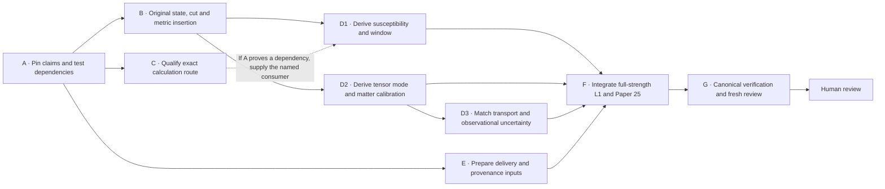

# L1 full-strength human-review readiness specification and plan

**Assessment 20 November 2026 · RED · Planning checkpoint while paused**

ROOT owns publication delivery and the signed numerical remainder. Executor owns the commissioned original-state and source construction. This plan proposes work packages and review roles. New assignments and capacity require the existing planner and accepted continuity packets at resumption. L1's original scientific scope is governed by [B3](../2026-08-01-publication-readiness/REMEDIATION_PLAN.md), [Phase 6a and its current successors](../../roadmaps/Phase6a_Roadmap.md), and the [publication strategy](../../PAPER_STRATEGY.md#2-architecture--four-tier-falsifiability-led). Branch custody and earlier delivery are in the [handoff inventory](L1_DELIVERY_HANDOFF_20261120.md).

**Audit correction.** Use the [sanity-check findings](L1_READINESS_SANITY_CHECK.md) as the entry point for package A. Reuse the existing 154-unit catalog, roadmap and finding planner. The accepted finite nonvanishing result did not require the pure-EHC sum. The G3 dashboard mismatch and decision preparation are ROOT-owned technical work. Finding 2.1 verifies dates, and original B3 requires distinct scientific evidence.

## Acceptance target and gap today

A human-review candidate is one frozen L1 revision, with its Paper 25 companion and impacted consumers, that makes the **full physical argument** reproducible. It derives the original normalized metric susceptibility and its physical window, identifies and calibrates the microscopic tensor channel against matter and light, and matches its retarded dynamics to the observational time-delay inference with controlled error. The GW170817 interval theorem must be applied only under its actual hypotheses. The allowed interval contains unity, and excluding endpoints establishes neither falsification nor a probability of fine tuning.

The deliverables are a clean venue-qualified render, a claim-to-proof/source/computation packet, independently accepted responses and numerical records, resolved provenance inputs, and fresh figure, claims, prose and full-bundle Stage 13 evidence. The exact revision must meet the canonical gates and bundle-green rule, with zero open critical/major blockers and at most five open advisories. Record required fixes through the existing writer after independent verification and re-invocation. The final human decision on publication and any voucher/submission steps follows this handoff. Human provenance attestations are a distinct earlier operator action and can be packaged for input before review.

Today PR117 demonstrates the **conditional kinematics** under an adopted law and window. It has useful scoped mathematics and numerical work, plus clean earlier L1 and Paper 25 renders. Its tracked metadata records RED, one blocker, Stage 10 pending and a required Stage 13 redo. The passages and evidence that would turn that conditional project calculation into a physical L1 prediction are the gap. Scope change or deferral requires a specific operator disposition under [PD-5](../../dev-loops/PRE_DECISIONS.md#L59).

## Canonical QA gate baseline

The latest pinned canonical measure is [PR117 `b6994984` composed with `a912c5542`](PR117_COMPOSED_MAIN_READINESS_20261119.md#20-november-venue-provenance-recheck). Live refs were verified for PR117, main `abe463036`, and Executor donor `3cc133c98`. Main subsequently absorbed the research-only PR126. This plan uses the last measured composition and requires a fresh recheck on the next candidate. Lights represent canonical baseline states. A green cell applies to its measured coverage. The separate science and release tables describe remaining readiness.

| Gate | Light | Exact-candidate acceptance check |
|---|:---:|---|
| G1 Citation integrity | 🟢 | All in-text keys resolve and the primary-source editions actually support the claimed statements, including Volovik's luminal result and the observational assumptions. Recheck after physical additions. |
| G2 Cross-paper consistency | 🟢 | L1, Paper 25 and any affected consumer, including D3 where the claim is carried, agree on interval, units, definitions and attribution. Re-run the existing cross-paper checks. |
| G3 Parameter provenance | 🔴 | Seven PROJECTED entries lack human verification dates. For every surviving input record its applicable source, role, units, uncertainty and actual human disposition via the existing registry/dashboard. Use the [seven-entry packet](REPAIR_DISPOSITION_HISTORY.md#l1-parameter-evidence-for-human-review). Attestations alone do not resolve the physical window or transport. |
| G4 Computation correctness | 🟢 | Static coverage for seven declared formulas. Ground each new formula in the existing graph with eligible tests and produce independently rerunnable numeric identity/limit controls, execution receipts and error budgets for the actual predictions. |
| G5 Lean proof substance | 🟢 | Check the actual statements, hypotheses, imports, reachable dependencies and axiom/purity/native receipts for any new relied-on Lean. The current pass covers the declared substrate, particularly conditional results. |
| G6 Assumption disclosure | 🟢 | Trace all assumptions and limits for the metric response, phase and regulator, speed reference, and time-delay inference to statements and evidence. |
| G7 Narrative grounding | 🟢 | Map each strengthened sentence and figure annotation to the actual theorem, primary source or computed result. Independently inspect meaning as well as graph presence. |
| G8 Production run health | 🟢 | Re-run applicable canonical build, compile and cross-layer checks on the final revision. Attach exact-head receipts, including renders, figure generation and relevant native or notebook execution. |
| G9 Numerical freshness | 🟢 | Regenerate numerical content through canonical tables/formulas and verify final plot, text, units, branch/domain and companion readback. |
| G10 First-claim verification | 🟢 | Recheck novelty wording on the new draft. Any first claim requires documented evidence of prior-art search and human disposition under the current gate. |
| G11 Fix propagation | 🔴 | The measured row identifies Stage 13 finding 2.1, whose declared verifier checks the two endpoint dates. Resolve its provenance and propagation scope through the existing process. Independently accept the original B3 construction under its separate scientific obligation and re-invoke reviewers on both scopes as applicable. |

Additional release checks currently **🟡 draft compile/venue and merge qualification**, with scoped positive evidence and exact-revision recheck required. **🔴 Fresh full-bundle Stage 13** is still required after repairs. **🔴 Human-review handoff** awaits the full scientific and QA package. Use the [gate definitions](../../READINESS_GATES.md) and [wave pipeline](../../WAVE_EXECUTION_PIPELINE.md).

## Claim backing and completion tests

Here green means independently established at the claim stated in that row. Yellow means a route or partial result is accepted. Red means a key construction needed by the claim is missing or the current physical inference is unsupported.

| Claim or enabling result | Light | Reuse and required evidence |
|---|:---:|---|
| **Conditional observational interval** | 🟢 | The assumed speed law gives `[(1−τ)^2,(1+τ)^2]` with width `4τ`, contains unity, and excludes the adopted endpoints. Reuse `GravitationalWaves.lean`, canonical numerical generation and PR117. Keep the assumptions explicit and rederive the observational comparison once the physical speed law and error band are available. |
| **Scalar bubble, conditional RPA and finite-point normalization** | 🟢 | Accepted exact cutoff scalar bubble with remainder, conditional RPA behavior, and original finite-point nonzero partition/temporal response theorem. Each is green at its stated scope. The finite-point proof already controls signed cancellation for its own target. [Phase 6a scoped evidence](../../roadmaps/Phase6a_Roadmap.md) |
| **Full signed pure-EHC c0** | 🟡 | The reviewed signed cover and 31/1,056 accepted representatives define a reproducible partial result. There is no qualified full completion route. First identify exactly which downstream acceptance criterion needs this coefficient and whether an equivalent certificate proves that criterion at the required scope. If the coefficient is required, deliver its exact value with total coverage, signed weights, normalization, reproducible computation and independent replay. Preserve this open research obligation even if a downstream edge is eliminated. |
| **Original physical state, cut and metric source** | 🔴 | The original-action source caps, ordered relative action, accepted obstructions and gauge comparison states constrain a candidate. Construct the actual physical domain, product, adjoint, positive normalized state and ordered cut. Recover the original periodic pairing, original kernels and first/mixed contact insertions, including the contracted physical Q00. Independently reproduce the controls and show how the construction addresses the existing obstruction witnesses. [Ordered source evidence](../2026-11-05-l1-physical-bridges/ORIGINAL_ORDERED_QUANTUM_CUT_ACCEPTANCE.md) · [Latest pre/post comparison evidence](https://github.com/NetRxn/SK_EFT_Hawking/blob/3cc133c98053d05e555ebe2c599253aebf476f35/docs/audits/2026-11-05-l1-physical-bridges/ORIGINAL_QUANTUM_PREPOST_CONSTRAINT_ACCEPTANCE.md) |
| **B3 physical susceptibility and window** | 🔴 | Identify the microscopic metric operator, tensor projection, regulated response and normalization to dimensionless chi_vest. Derive the actual matched bubble and effective coupling with the stated cutoff scale, units, domain and stability margins. Evaluate with independent reference/limit checks and bound the uncertainty. The full-strength target is a derivation of the stated [0.1,10] window from defensible domain conditions, including endpoint meaning. Stability alone fails near the RPA pole. If the original domain yields a different range, provide the derivation, failed premise or discrepancy and decision evidence for the operator. [B3 and successors](../../roadmaps/Phase6a_Roadmap.md) |
| **Propagating graviton mode, matter coupling and speed law** | 🔴 | Reuse the reviewed metric–matter and tensor/photon research contracts and calibrated normalization obstructions. Derive the constrained quadratic equations, stable physical pole, positive norm and physical polarizations. Derive matter/EM coupling and the common clock and ruler from the same physical construction. Independently verify speed matching to that reference and obtain the assumed square-root law within controlled accuracy if the physical model supports it. An incompatibility requires evidence and specific disposition. [Reviewed metric–matter checkpoint](https://github.com/NetRxn/SK_EFT_Hawking/pull/126) |
| **Retarded transport and observational accuracy** | 🔴 | The existing conditional pole algebra is a test for the proposed physical tensor. Derive the actual retarded response, contact subtraction and transport coefficients, including their signs, dimensions and the Hz-to-angular-frequency convention. Establish a supported frequency band and bound dispersion, attenuation, approximations and wavepacket arrival-time effects against the GW170817 inference with stated emission assumptions. The error budget must justify the claimed interval and exclusions. The `100` and `10⁻³⁰` example supplies no physical calibration. [Conditional transport analysis](L1_RETARDED_TRANSPORT_MATCHING.md) |

## Execution dependency graph

Solid edges are required deliveries. The conditional path from numerical work is an explicit question for the first milestone. The diagram shows B3 as a candidate consumer. A must route the output to the actual earliest consumer before that consumer can pass. Detailed ordering within the physical construction is provisional until the common source and calibration interfaces are pinned.

## Milestones and research spikes

| Package | Execution and acceptance criteria |
|---|---|
| **A · Freeze the claim and dependency matrix** | ROOT leads with Executor source input and fresh claims/mathematics review. Pin PR117, original action and parameter regime, the earlier review findings and exact accepted donors. For every full-strength claim write the output needed, consuming equation/theorem, required hypotheses and current evidence. Start from Phase 6a's recorded finite-point result, which needs no pure-EHC c0 evaluation. If a remaining claim needs c0, identify the exact consumer and whether it needs the value, sign, lower bound, or a certificate in a different regime. Compare the accepted finite-point theorem and document a proof or a counterexample for any proposed substitution. **Exit:** agreed claim-level dependency matrix with explicit evidence for the c0 edge or an unresolved decision. No schedule for all groups based on an unestablished edge. |
| **B · Prove original-state and source compatibility** | Executor continues commissioned construction from the ordered source caps and pre/post gauge comparison. Freeze one candidate against the R3 charter. Test the published adverse cases, source-common kernels, preserved pairing, positivity and both first/mixed insertion identities. **Exit:** independent math and original-source reviewers accept the actual product/adjoint/state/cut and physical Q00 at the required scope. If the candidate fails, record the exact witness, the next viable construction and any premise that would require operator disposition. |
| **C · Establish a completion route where the claim needs one** | ROOT owns this package. A bounded spike compares certificate/reduction and exact batched contraction using the accepted cover, reviewed controls and the retained high-cost failure cases. Proposed benchmark shape is low/median/high cost strata plus a previously cap-limited group, with a held-out group frozen before implementation. Freeze the available compute and review budget and the required coverage before measuring. Measure full author and independent cost, peak memory, restart behavior, exact signed agreement, coverage and estimated total resource range. **Exit:** independent replay plus an accepted certificate for the named consumer, or a budget-compatible completion schedule covering all still-required groups with an exact aggregation and verification protocol. If neither qualifies, report the bottleneck and proposed analytic reduction or budget decision and stop adding isolated groups for throughput credit. A second traversal of the same calculation is sufficient only when source binding, coverage and independence are demonstrated. |
| **D1 · Deliver the matched B3 result** | ROOT owns delivery, with commissioned physics support through the existing roadmap. Before a full run, pin the physical projection and domain, and test normalization and coupling sensitivity against the scalar bubble and near-pole control. **Exit:** independently accepted regulated response, derived physical interval and error/domain controls linked to the exact B3 finding. A result at a single tuned point is insufficient. |
| **D2 · Deliver the physical speed model** | For allocation on resumption, ROOT specifies the exact tensor/matter outputs and commissions the construction through the existing roadmap. Start with the research already on main and the reviewed source-state obstructions. **Exit:** independent dynamics and source review reproduces the physical pole, polarization, normalization, matter/EM reference and speed relationship under shared assumptions. |
| **D3 · Deliver the observable** | After D2 supplies the physical tensor and reference, derive its retarded response and perform the band/error calculation. A bounded early design may freeze sign, unit and frequency test cases using the existing conditional files. **Exit:** independent transport and observational review can reproduce the physical response and bound, including convention controls and the impact of propagation/source uncertainties on the final claim. |
| **E · Prepare and qualify bounded publication delivery** | ROOT uses PR117 for L1, selectively taking relevant PR118 proof work and exact reviewed research checkpoints. Prepare the seven G3 operator decisions from the existing packet. On resume, qualify an isolated current-main manuscript/Paper 25 checkpoint under the existing merge process, with scoped evidence and all dependent consumers. **Exit:** recorded exact-base qualification, required independent review and remote main readback for any checkpoint that meets merge criteria. This can run alongside science within the established allocation and earns bounded delivery credit. |
| **F/G · Produce the full-strength review package** | Integrate the accepted course of construction and propagate through metadata, Lean/Python where required, figures, tables, Paper 25 and affected consumers. Link every key claim to pinned proof or accepted derivation, inputs, tests and limitations. Run the existing applicable scoped and full merge profiles, authoritative Lean build/extraction where required, graph and `bundle_readiness.py`, figure/render and claims/prose review. Invoke fresh full-bundle Stage 13 through the existing reviewer profile, repair findings and independently re-invoke. Use `scripts/close_finding.py` with the recorded verifier and rerun the graph on the resulting exact revision. **Exit:** verified QA exit, clean final PDF/companion, signed provenance, review and closure receipts, and full-strength operator packet. |

Across packages use the existing planner, [continuity contract](../../dev-loops/CODEX_CONTINUITY.md), and [Lean worker instructions](../../../.claude/plugins/skeft-qa/agents/lean-worker.md). Search Lean by statement and type via LSP on the exact candidate, including imports and `lean/lean_deps.json`, before commissioning new proofs. Use the repository's authorized native slot route for builds and extraction. Source reading, review and drafting can use cloud capacity. Exact computation and native verification follow their actual resource and custody constraints. Merge qualified material at stable checkpoints.

**Progress reporting:** report which acceptance criteria passed, evidence for the remaining critical path, and measured cost or obstruction where it changes execution. The next decision milestone is a scoped readback of the existing catalog and Phase 6a successor, with only changed or unresolved dependencies examined. Reuse B's existing results before commissioning new work. Report a numerical count only alongside the consumer it enables and whether a complete implementation route has qualified. This document is a plan. Its spikes and execution are pending.
